# API Hexagonal · Integración de facturación IPS → SysCafé

Servicio REST en **Quarkus** que recibe el JSON de facturación de una IPS, lo convierte al formato de documento de SysCafé (contrato 1.3) usando tablas de equivalencias, lo guarda y lo deja disponible para que SysCafé lo consulte. Incluye un portal web ("Punto y coma"), reportes en PDF y control de acceso por roles.

Proyecto del curso **Desarrollo Orientado a Servicios 2026-2** (Universidad Santo Tomás, Tunja).

---

## Cómo abrir la aplicación

> **Importante:** para ver bien la aplicación hay que entrar por
>
> **http://localhost:8080/static/login.html**
>
> Es el portal completo (menú, facturas, clientes, equivalencias, etc.). Si se abre otra ruta (por ejemplo `http://localhost:8080/`), Quarkus redirige al panel básico `/panel`, que es una vista más simple y no tiene el diseño del portal.

Usuario inicial: `profe` · Contraseña: `cloud2026` (rol Administrador). Se crea solo la primera vez, desde `billing.user` y `billing.password` de `application.properties`. Cámbiala antes de entregar o desplegar.
Usuario con rol de operador: `operador1` · Contraseña: `clave-segura1`
Usuario con rol de visor: `visor1` · Contraseña: `clave-segura1`

Otras rutas útiles:

| Ruta | Para qué |
|---|---|
| `/static/login.html` | Portal web (entrada recomendada) |
| `/panel` | Panel básico en Qute (solicitudes, recibir JSON, gestión) |
| `/q/swagger-ui` | Documentación OpenAPI / Swagger UI |

---

## Requisitos

- **Java 21** (o el que defina el `pom.xml`)
- **Maven** (se incluye `mvnw`, no hace falta instalarlo)
- **MySQL o MariaDB**. Se probó con **XAMPP** (MariaDB) en `localhost:3306`, usuario `root` sin contraseña.

## Puesta en marcha

1. Arranca **MySQL** desde el panel de XAMPP.
2. No hace falta crear la base: la URL incluye `createDatabaseIfNotExist=true` y Hibernate crea las tablas (`schema-management.strategy=update`).
3. Desde la carpeta del proyecto:

   ```shell
   ./mvnw quarkus:dev          # en Windows: mvnw.cmd quarkus:dev
   ```

4. Abre **http://localhost:8080/static/login.html** e inicia sesión.

Al primer arranque la aplicación crea automáticamente:
- el usuario administrador inicial (`profe`);
- las **equivalencias iniciales** (tipos de documento, sedes, tipos de identificación, servicios, formas de pago y ajustes). Solo se cargan si la tabla `equivalences` está vacía; después se administran desde el portal.

### Configuración (`src/main/resources/application.properties`)

| Propiedad | Descripción |
|---|---|
| `quarkus.datasource.*` | Conexión a MySQL/MariaDB |
| `quarkus.hibernate-orm.dialect` | `MariaDBDialect` (XAMPP usa MariaDB; con el dialecto de MySQL 8 fallan los `FOR UPDATE OF`) |
| `billing.user` / `billing.password` | Administrador inicial (solo se usa si la tabla de usuarios está vacía) |
| `billing.jwt-secret` | Clave para firmar los tokens (HS256, 1 hora). Cámbiala en producción |
| `billing.syscafe-token` | Token que usa SysCafé para consultar `GetFacturas` (variable `SYSCAFE_TOKEN`) |
| `billing.alert-hours` | Horas tras las que una solicitud pendiente genera alerta |
| `billing.page-size` | Tamaño de página de `GetFacturas` |
| `invoice.issuer.*` | Datos del emisor que salen en el PDF de la factura |

> Los scripts de `src/main/resources/db/migration` (Flyway, pensados para PostgreSQL) **ya no se ejecutan**: con MySQL/MariaDB las tablas las crea Hibernate a partir de las entidades.

---

## Roles y permisos

Hay tres permisos (`READ`, `CONVERT`, `MANAGE`) y tres roles. Todo se define en un solo lugar: el enum `Role` (`usta/domain/model/Role.java`).

| Rol | Permisos | Qué puede hacer |
|---|---|---|
| **Administrador** | READ + CONVERT + MANAGE | Todo: convertir facturas, ver reportes, editar o eliminar facturas, administrar clientes, equivalencias y usuarios |
| **Operador** | READ + CONVERT | Ver y **convertir facturas** (enviar JSON, reprocesar solicitudes). No administra nada |
| **Visualizador** | READ | Solo **ver** facturas, solicitudes, alertas y reportes PDF |

Qué ve cada rol en el portal:

| Sección | Administrador | Operador | Visualizador |
|---|:-:|:-:|:-:|
| Resumen, Facturas, Consulta SysCafé, Clientes, Mi cuenta | ✔ | ✔ | ✔ |
| Enviar factura (convertir) | ✔ | ✔ | ✘ |
| Equivalencias | ✔ | ✘ | ✘ |
| Editar / eliminar facturas, editar clientes | ✔ | ✘ | ✘ |

Reglas de seguridad:
- **Denegar por defecto:** un endpoint sin `@RequiresPermission` exige `MANAGE`.
- El token solo lleva el nombre de usuario; el rol se lee de la base de datos en cada petición, así que un cambio de rol o desactivar a un usuario surte efecto de inmediato.
- Las contraseñas se guardan con PBKDF2. Mínimo 8 caracteres.
- No se puede eliminar, desactivar ni degradar al **último administrador activo**.
- Ocultar botones en el portal es solo cosmético; el bloqueo real lo hace el servidor con un `403`.

### Crear y administrar usuarios

Los endpoints `/usuarios` son solo para Administradores. Ejemplo con `curl` (en Windows PowerShell usa `curl.exe`):

```shell
curl.exe -u profe:cloud2026 -X POST http://localhost:8080/usuarios ^
  -H "Content-Type: application/json" -H "Origin: http://localhost:8080" ^
  -d "{\"usuario\":\"operador1\",\"password\":\"clave12345\",\"rol\":\"OPERADOR\"}"
```

Roles aceptados: `ADMINISTRADOR`, `OPERADOR`, `VISUALIZADOR` (también en inglés: `ADMINISTRATOR`, `OPERATOR`, `VIEWER`).

| Método | Ruta | Acción |
|---|---|---|
| GET | `/usuarios` | Listar |
| POST | `/usuarios` | Crear |
| PUT | `/usuarios/{id}` | Cambiar rol (`rol`), estado (`activo`) o contraseña (`password`); lo que no se envía no cambia |
| DELETE | `/usuarios/{id}` | Eliminar |

El encabezado `Origin` es obligatorio en las peticiones que modifican datos con autenticación Basic (protección contra CSRF).

---

## Flujo de facturación

```
POST /staging  →  conversión con equivalencias  →  contrato SysCafé 1.3  →  guardado  →  conciliación de totales
```

1. `POST /staging` recibe el JSON original de la IPS y registra una **solicitud**.
2. Se convierte con las equivalencias (tipo de documento, sede, tipo de identificación, servicio, forma de pago, ajustes).
3. Se concilian los totales (tolerancia de 0,01).
4. Resultado de la solicitud:

| Estado | HTTP | Significado |
|---|---|---|
| `CONVERTED` | 201 | Convertida y guardada |
| `PENDING` | 202 | Falta algo (por ejemplo una equivalencia); se puede **reprocesar** cuando se corrija |
| `REJECTED` | 409 | Rechazada (duplicada o no cuadra) |

Si una solicitud queda en `PENDING` con un mensaje tipo *"Falta equivalencia para …"*, agrega esa equivalencia (Equivalencias en el portal, con rol Administrador) y usa **Reprocesar** sobre la solicitud.

### Endpoints principales

| Método | Ruta | Permiso | Descripción |
|---|---|---|---|
| POST | `/login` | público | Devuelve `token`, `usuario` y `rol` |
| POST | `/staging` | CONVERT | Recibir y procesar el JSON original |
| GET | `/staging` | READ | Documentos convertidos |
| PUT | `/staging/{id}` | MANAGE | Actualizar un documento convertido |
| DELETE | `/staging/{id}` | MANAGE | Eliminar un documento convertido |
| GET | `/solicitudes`, `/solicitudes/{id}`, `/solicitudes/{id}/historial` | READ | Consultar solicitudes |
| POST | `/solicitudes/{id}/reprocesar` | CONVERT | Reprocesar una solicitud pendiente |
| GET | `/alertas` | READ | Solicitudes pendientes por mucho tiempo |
| GET | `/GetFacturas?fecha=AAAA-MM-DD&consec=1` | READ o token de SysCafé | Documentos para la importación de SysCafé |
| GET | `/clientes`, `/equivalencias`, … | READ | Consultar catálogos |
| POST/PUT/DELETE | `/clientes`, `/equivalencias`, … | MANAGE | Mantener catálogos |
| GET | `/panel/facturas/{id}/documento.pdf` | READ | Factura en PDF |
| GET | `/panel/reportes/procesos.pdf` | READ | Reporte de procesos en PDF |

La documentación interactiva completa está en `/q/swagger-ui`.

---

## Arquitectura (hexagonal)

```
src/main/java/usta
├── domain            Modelos y reglas de negocio puras (BillingDocument, User, Role, Permission…)
├── application
│   ├── port/in       Casos de uso que ofrece la aplicación (ProcessDocuments, ManageUsers…)
│   ├── port/out      Lo que la aplicación necesita de afuera (repositorios, hasher, transacción)
│   └── usecase       Implementaciones en Java puro (ProcessingService, UserService…)
└── infrastructure
    ├── adapter/in    REST (Resources), portal web (Qute) y lectura de JSON
    ├── adapter/out   Persistencia JPA (entidades, mappers, repositorios)
    ├── security      Filtro de acceso, JWT, PBKDF2, @RequiresPermission
    └── config        Assembly (conecta los servicios puros), arranque (admin y equivalencias iniciales)
```

El dominio y los casos de uso no dependen de Quarkus ni de JPA: la clase `Assembly` los crea y les inyecta los adaptadores.

## Tecnologías

Quarkus 3 · Quarkus REST + Jackson · Qute · Hibernate ORM · MySQL/MariaDB · SmallRye OpenAPI (Swagger UI) · OpenPDF · java-jwt · Lombok.

## Problemas frecuentes

| Síntoma | Causa y solución |
|---|---|
| El portal se ve sin diseño o distinto | Entra por `http://localhost:8080/static/login.html` |
| `Falta equivalencia para …` | Falta una fila en equivalencias; agrégala y reprocesa la solicitud |
| `Data too long for column 'original_payload'` | La columna se creó antes como `varchar(255)`. Ejecuta `ALTER TABLE integration_requests MODIFY original_payload LONGTEXT;` y `ALTER TABLE event_messages MODIFY message TEXT;` |
| Error de sintaxis con `for update of …` | Falta el dialecto `MariaDBDialect` en `application.properties` |
| `Duplicate entry` o dos usuarios con el mismo nombre | Ejecuta `ALTER TABLE users ADD UNIQUE (username);` (si la tabla ya existía sin la restricción) |
| 401 al iniciar sesión | Usuario o contraseña incorrectos, o el usuario está inactivo |
| 403 en una operación | Tu rol no tiene permiso para eso |
| "Sin rol" en el menú | Cierra sesión y vuelve a entrar (el rol se guarda al iniciar sesión) |

> Hibernate con `update` crea tablas y columnas nuevas, pero **no modifica** columnas que ya existen. Si cambias el tipo de una columna en una entidad, hay que alterarla a mano o recrear la base (`DROP DATABASE billing;`).

## Capturas de funcionamiento

### Inicio de sesión
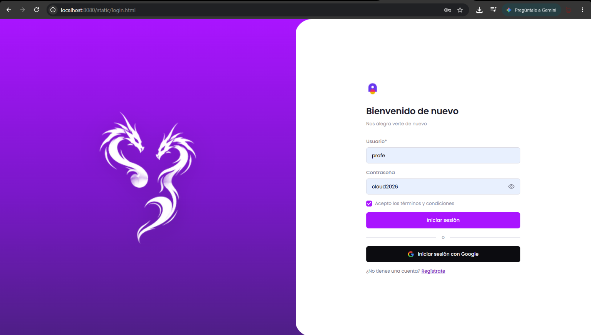

### Registro de cuenta
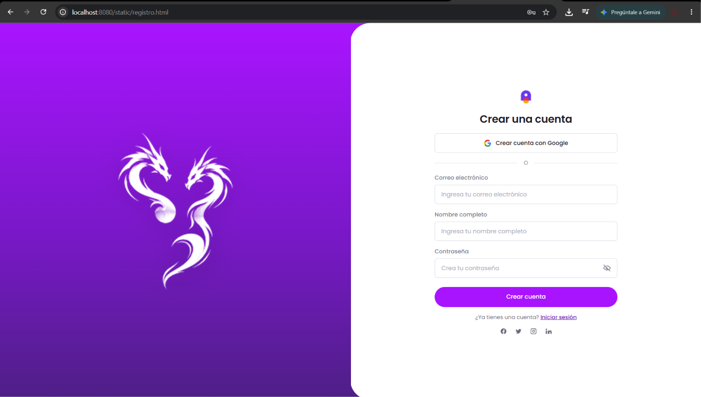

### Dashboard de administrador
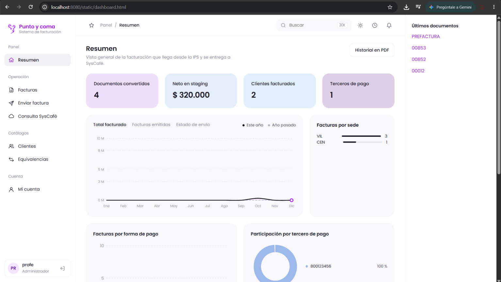

### Facturas registradas
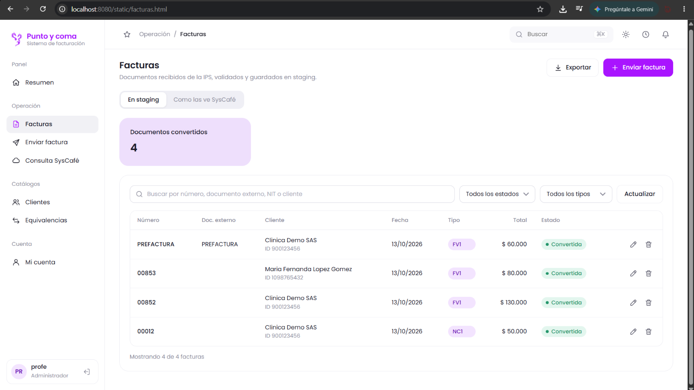

### Enviar facturas
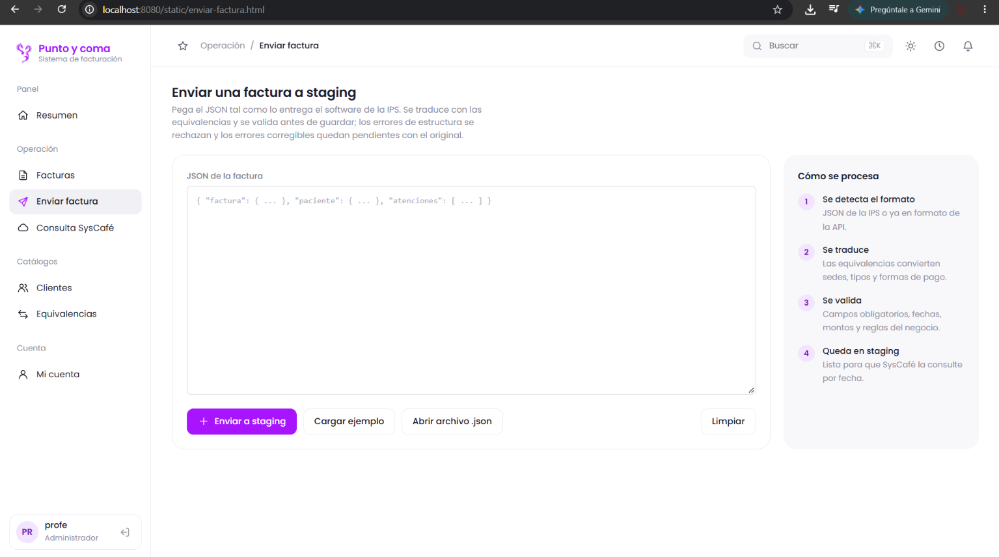

### Editar una factura
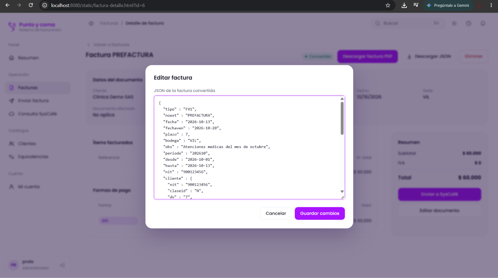

### Consultar en SysCafé
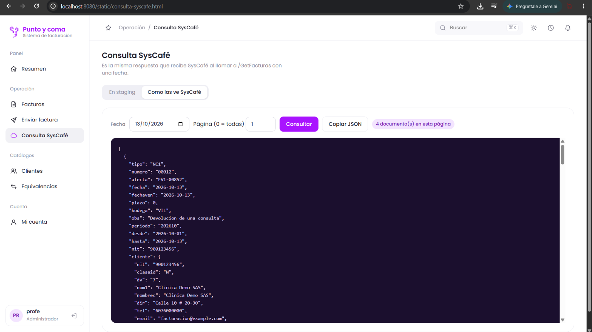

### Clientes
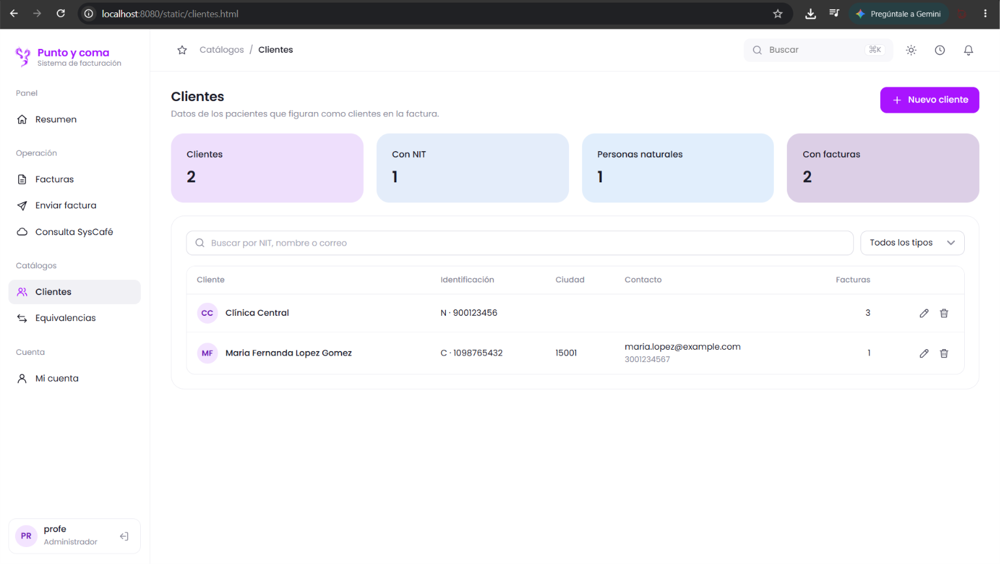

### Registrar nuevo cliente
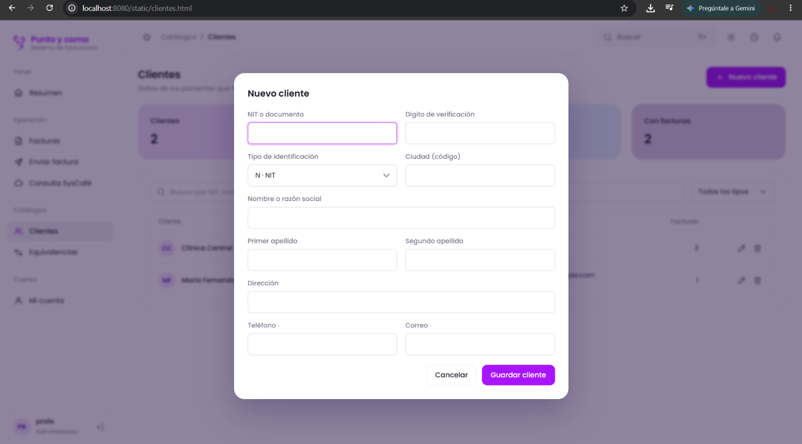

### Editar un cliente
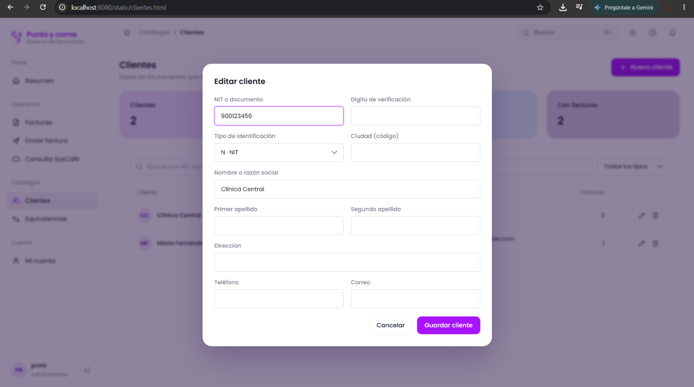

### Equivalencias
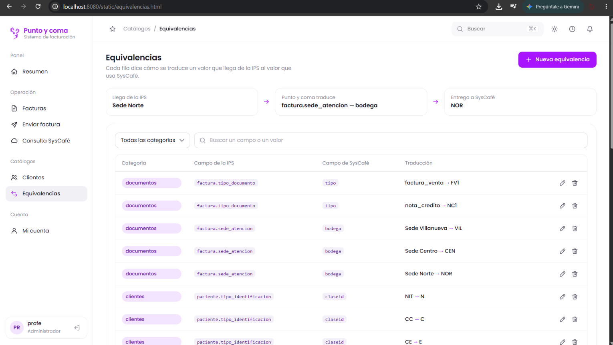

### Crear una equivalencia
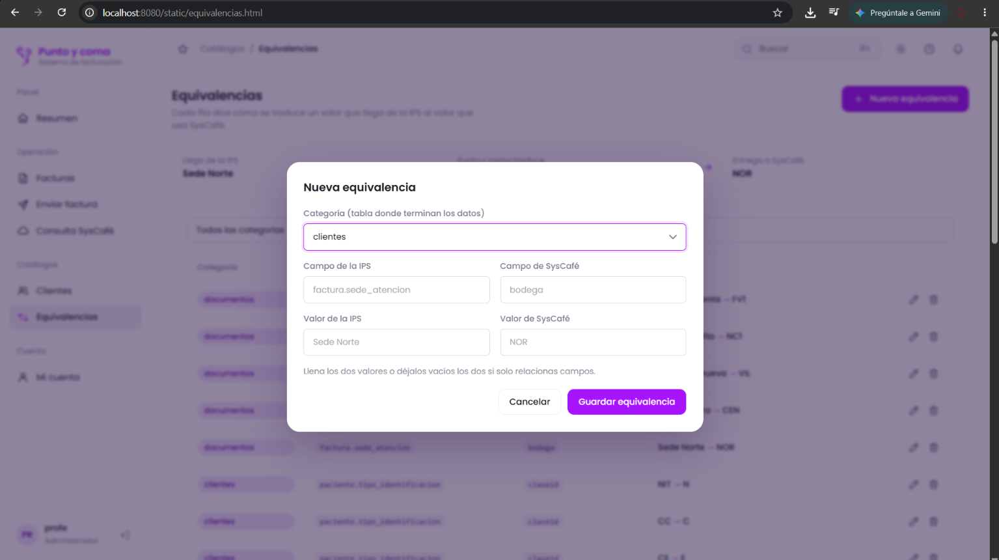

### Editar una equivalencia


### Configuración de la cuenta
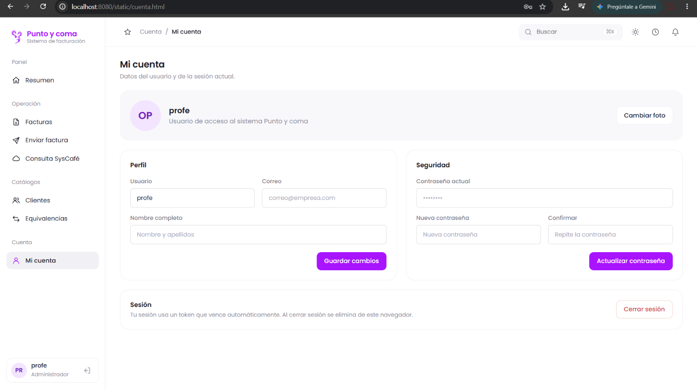

### Dashboard de visor
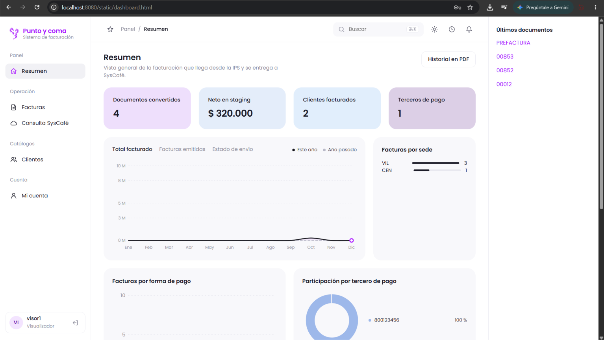

### Dashboard de operador
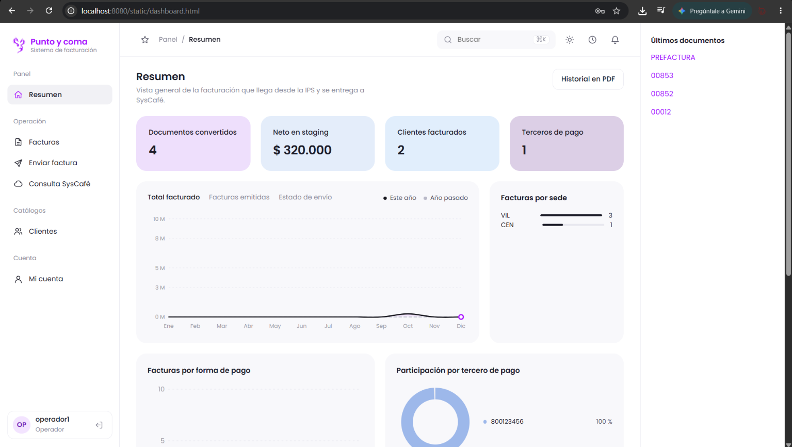

### Swagger
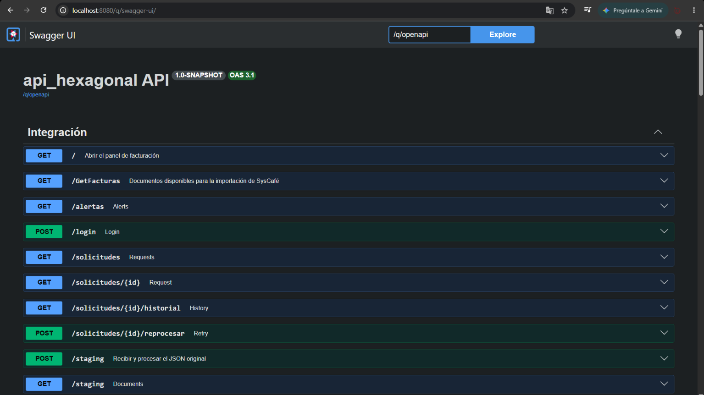